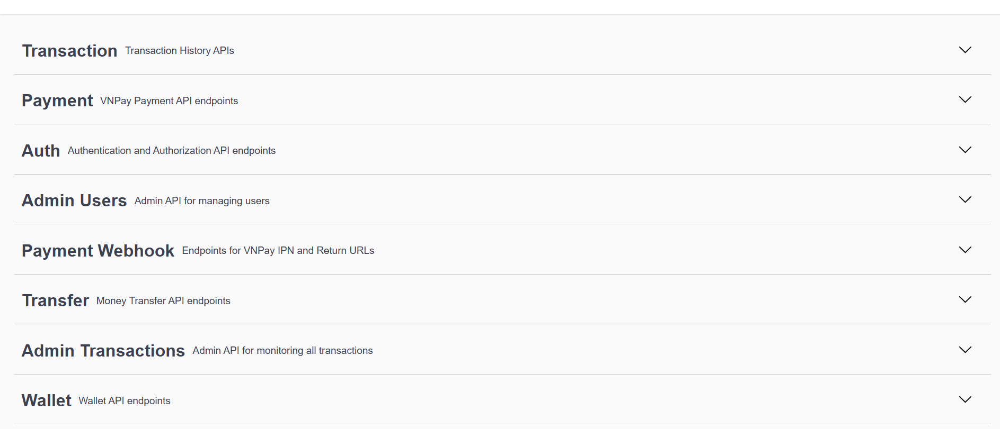
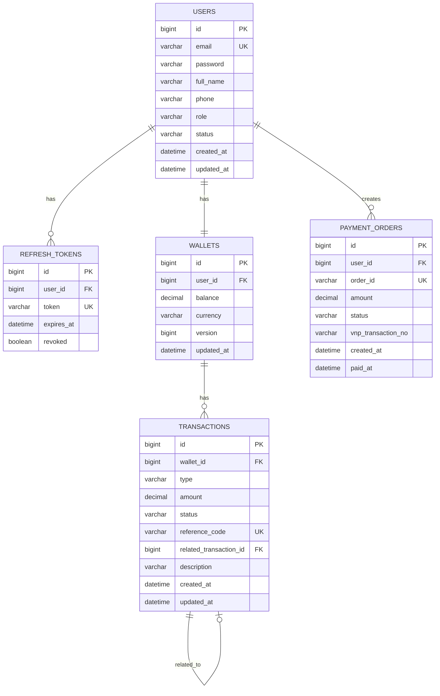
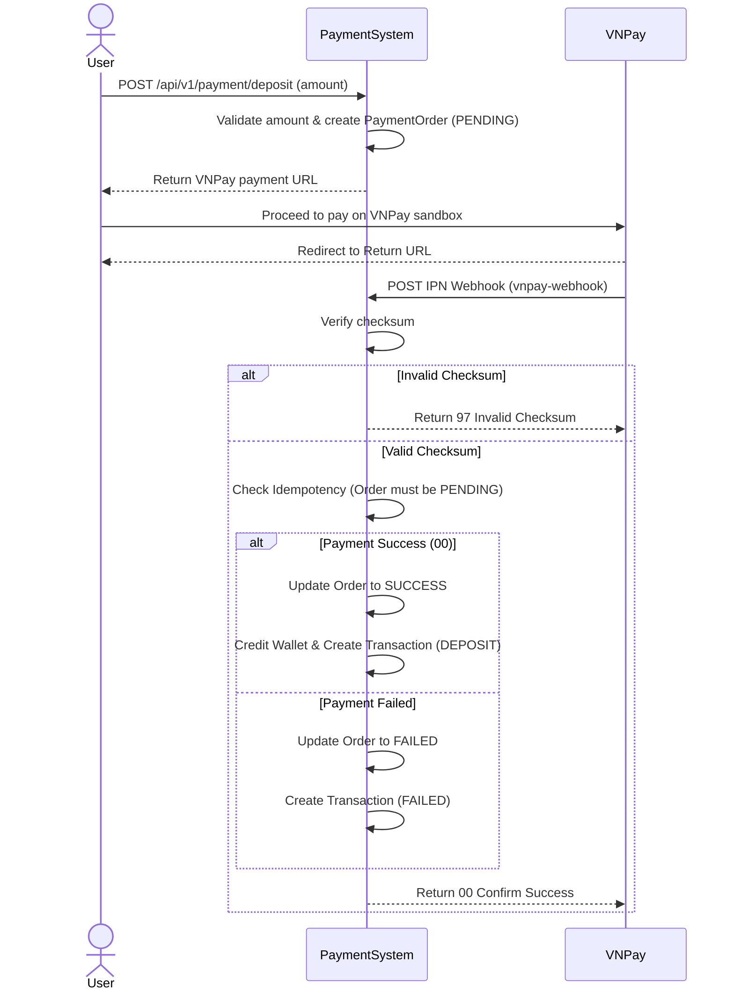
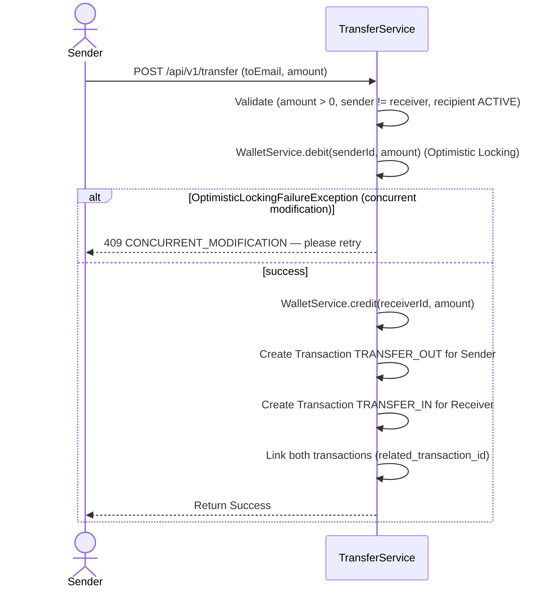
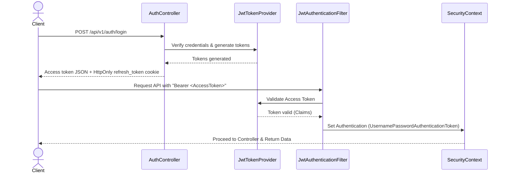

# Payment System

[](https://adoptium.net/)
[](https://spring.io/projects/spring-boot)
[](#testing)

A monolithic backend service (REST API) built with Spring Boot for a simple e-wallet system. It handles user registration, wallet balance management, internal fund transfers with concurrency control, and integrates with the VNPay sandbox for depositing funds.

## Demo



## Features

- **Account Management**: Register, login, refresh tokens, and logout. Single-device login policy is enforced by revoking previous refresh tokens upon new login.
- **Wallet & Balance**: Automatically provisions a wallet for new users. Users can retrieve their current balance.
- **VNPay Deposit**: Create a deposit order returning a VNPay payment URL. A webhook endpoint processes the VNPay IPN callback to credit the wallet exactly once (idempotent).
- **Fund Transfer**: Secure internal transfer between users. Enforces self-transfer restrictions, sufficient balance checks, and handles concurrent requests using Optimistic Locking.
- **Transaction History**: Track all deposit, transfer_in, and transfer_out activities. Provides a paginated history endpoint with filtering by type, status, and date.
- **Admin Management**: Dedicated admin endpoints to fetch all system transactions and lock/unlock user accounts.

## Tech Stack

| Layer            | Technology                                  |
|------------------|---------------------------------------------|
| Language         | Java 17                                     |
| Framework        | Spring Boot 3.4.1                           |
| Build Tool       | Maven                                       |
| Database         | PostgresSQL 16                              |
| ORM              | Spring Data JPA (Hibernate)                 |
| Security         | Spring Security + jjwt (0.12.6)             |
| Payment Gateway  | VNPay Sandbox                               |
| Documentation    | springdoc-openapi-starter-webmvc-ui (2.8.4) |
| Containerization | Docker, Docker Compose                      |
| Testing          | JUnit 5, Mockito                            |

## Getting Started

### Prerequisites

- Java 17
- Docker & Docker Compose
- Maven

### Installation

```bash
git clone https://github.com/TrinhDacNhatMinh/payment-system-backend.git
cd payment-system-backend
cp src/main/resources/application.yaml.example src/main/resources/application.yaml
cp docker-compose.yml.example docker-compose.yml
# Fill in application.yaml and docker-compose.yml before starting.
docker compose up -d --build
```

### Configuration

Copy `src/main/resources/application.yaml.example` to `src/main/resources/application.yaml` and fill in the real database, JWT, and VNPay values. The real YAML is ignored by Git; commit only the example with placeholder values. JWT signing uses a raw UTF-8 secret of at least 32 bytes.

Spring reads literal values from `application.yaml`. It does not import `.env` or require environment placeholders. Both IDE and Docker use this file. Keep the IDE working directory at the backend project root when running Maven commands.

Copy `docker-compose.yml.example` to `docker-compose.yml` and fill in its literal PostgreSQL settings. Keep the database name, username, and password consistent with `application.yaml`. Compose only overrides the backend property `SPRING_DATASOURCE_URL` to use `db:5432` instead of `localhost`. Neither IDE nor Docker needs a `.env` file. The real Compose file is ignored by Git; commit only its example.

The Dockerfile packages the local YAML into the JAR/image. Rebuild the image after changing this file, and do not publish an image containing private configuration. Someone cloning the repository must create their local YAML before building.

`ddl-auto: create` and `create-drop` recreate tables and delete data. The example uses `update` for local development; use managed migrations and `validate` for deployed environments. Changing PostgreSQL credentials in Compose does not update users or passwords in an existing `pg_data` volume.

### Running

```bash
# Run the application locally with the project root as the working directory
mvn spring-boot:run

# Build and run the backend and PostgreSQL with Docker
docker compose up -d --build

# Run tests
mvn test
```

## API Documentation

**Swagger UI:** http://localhost:8080/swagger-ui.html

| Method | Endpoint                          | Description                       | Auth  |
|--------|-----------------------------------|-----------------------------------|-------|
| GET    | `/api/v1/auth/csrf`               | Get masked CSRF token and HttpOnly cookie | None |
| POST   | `/api/v1/auth/register`           | Register a new user               | None  |
| POST   | `/api/v1/auth/login`              | Return access token and set refresh cookie | None |
| POST   | `/api/v1/auth/refresh`            | Rotate tokens using refresh cookie | Refresh cookie |
| POST   | `/api/v1/auth/logout`             | End session and clear cookies; repeatable | CSRF + Origin; optional refresh cookie |
| GET    | `/api/v1/wallet/me`               | Get current user's wallet balance | USER  |
| POST   | `/api/v1/payment/deposit`         | Create a VNPay deposit URL        | USER  |
| POST   | `/api/v1/payment/vnpay-webhook`   | VNPay IPN Webhook callback        | None  |
| GET    | `/api/v1/payment/vnpay-return`    | VNPay Return URL callback         | None  |
| POST   | `/api/v1/transfer`                | Transfer funds to another user    | USER  |
| GET    | `/api/v1/transactions`            | View personal transaction history | USER  |
| GET    | `/api/v1/admin/transactions`      | View all system transactions      | ADMIN |
| PATCH  | `/api/v1/admin/users/{id}/lock`   | Lock a user account               | ADMIN |
| PATCH  | `/api/v1/admin/users/{id}/unlock` | Unlock a user account             | ADMIN |

### Refresh token cookie

Login accepts the existing email/password JSON request. Login and refresh return `accessToken`, `tokenType`, `expiresIn` in seconds, and `user: { id, email, role }` inside `data`. The user fields come from the authenticated user in the service. No separate profile endpoint is required, and this session response does not include fullName, status, or password. The refresh token is sent exclusively in the `Set-Cookie` header, not in JSON.

Example login/refresh data:

```json
{
  "accessToken": "<jwt>",
  "tokenType": "Bearer",
  "expiresIn": 1800,
  "user": {
    "id": 1,
    "email": "user@example.com",
    "role": "USER"
  }
}
```

The frontend can use `user` to display the current session. The backend remains responsible for authorization; displaying a role in the UI does not grant permissions.

The service returns an `AuthResponse` containing the prepared cookie header value. Its `cookie` component is annotated with `@JsonIgnore` and hidden from the OpenAPI schema; the controller uses `response.cookie()` only for `Set-Cookie`. Cookie creation and deletion are handled by `RefreshTokenCookieProvider`.

The `refresh_token` cookie is HttpOnly, uses `Path=/api/v1/auth` and `SameSite=Lax`, and has no Domain attribute. Its Max-Age is derived from `jwt.refresh-expiration` (configured in milliseconds), matching the lifetime of the stored refresh token. Login and refresh responses use `Cache-Control: no-store`.

Configure cookie transport in your local `application.yaml`:

```yaml
auth:
  allowed-origins: http://localhost:5173
  refresh-token-cookie:
    secure: false # Local HTTP only; use true with HTTPS
```

Secure defaults to `true` when this setting is absent. The configuration example explicitly uses `false` for local HTTP.

Refresh and logout accept the `refresh_token` cookie and do not require a request body. The old `{"refreshToken":"..."}` JSON body is no longer used. Refresh rotates the token and replaces the cookie. Successful logout revokes the user's refresh tokens and expires the cookie with the same name and scope and `Max-Age=0`.

Refresh still returns HTTP 401 `REFRESH_TOKEN_MISSING` for a missing/blank cookie and keeps its expired, revoked, and unknown-token errors. Logout returns HTTP 200 and clears cookies when the token is missing, blank, unknown, or already revoked. An existing, unrevoked token causes all refresh tokens for its user to be revoked, even if that token has expired. A previously revoked token does not revoke a newer session. Database/system failures remain errors and do not clear cookies. Access tokens already issued remain valid until expiration. Concurrent login/refresh/logout serialization remains a separate task.

Browser clients should use `credentials: "include"` for cross-origin auth requests and must not read or store the refresh token in JavaScript. CORS now uses the same `auth.allowed-origins` allowlist as the auth Origin checks. Concurrent-session serialization remains follow-up work.

### CSRF and Origin checks

Before POST register/login/refresh/logout, call `GET /api/v1/auth/csrf` without a bearer token. Its `BaseResponse.data` contains `{ "headerName": "X-XSRF-TOKEN", "token": "<masked-token>" }`. Keep the token in memory and send it in the named header, together with the matching cookie. JavaScript must use the JSON token, not the raw cookie value.

The `XSRF-TOKEN` repository cookie is HttpOnly, host-only, `Path=/api/v1/auth`, `SameSite=Lax`, and a session cookie. Its Secure flag follows `auth.refresh-token-cookie.secure`. The endpoint resolves the deferred token and uses `Cache-Control: no-store`; it does not create an HTTP session.

All four auth POSTs require an exact `Origin` from `auth.allowed-origins` (comma-separated values for multiple origins). An absent allowlist rejects all auth POST origins. Missing, `null`, or unlisted origins return HTTP 403 `ORIGIN_NOT_ALLOWED`. A missing/blank CSRF header or missing repository cookie returns `CSRF_TOKEN_MISSING`; an invalid/mismatched masked token returns `CSRF_TOKEN_INVALID`. Errors use `BaseResponse` and occur before the auth service runs. API clients such as Swagger/Postman must also supply Origin, the CSRF header, and cookies.

Browsers set Origin automatically. To test auth POSTs from local Swagger UI hosted at `http://localhost:8080`, explicitly add that origin to the local allowlist and supply the JSON CSRF token in the documented header. The example only allows the frontend origin `http://localhost:5173`.

Successful login/logout delete the old CSRF cookie; fetch a fresh token before the next auth POST, including a repeated logout. Refresh preserves the CSRF cookie. Rejected Origin/CSRF checks do not revoke refresh tokens or clear the refresh cookie; repeatable logout does not bypass these checks. Auth POST responses use `Cache-Control: no-store`. Bearer business endpoints and VNPay callbacks do not require this CSRF token.

This changes the auth request contract: clients that omit CSRF/Origin will now receive 403. CORS for `/api/v1/**` allows credentials from configured origins (local: `http://localhost:5173`), methods GET/HEAD/POST/PATCH/OPTIONS, and request headers Content-Type/Authorization/X-XSRF-TOKEN. Valid preflight is handled before authentication and CSRF. API errors for an allowed origin retain CORS headers; unlisted origins receive no CORS access. Origin rejections use `ORIGIN_NOT_ALLOWED`; unsupported CORS methods/headers use `ACCESS_DENIED`, both in `BaseResponse`. Set-Cookie is not exposed to JavaScript. New CSRF/CORS tests have been added but have not been executed, and browser integration is unverified; earlier test counts below do not validate these changes.

## Project Structure

```text
src/main/java/com/minh/paymentsystem/
├── auth/
├── common/
├── config/
├── payment/
├── transaction/
├── transfer/
├── user/
└── wallet/
```

---

## Architecture & Design Docs

### Overview

The system follows a **Monolith** architecture organized by **package-by-domain** principles. Each domain (auth, wallet, payment, etc.) encapsulates its own Controller, Service, Repository, and DTOs. This reduces cross-domain coupling. A `common` package serves as the shared kernel for global exception handling and base response structures.

### Service Dependency

The application enforces boundaries by ensuring Controllers only call their respective Services, and Services do not directly manipulate the Repositories of other domains.

- `AuthController` -> `AuthService` -> `UserService`, `RefreshTokenService`, `WalletService` (to create wallet)
- `TransferController` -> `TransferService` -> `UserService` (to fetch user info), `WalletService` (for debit/credit), `TransactionService` (to log transactions)
- `PaymentController` -> `PaymentService` -> `UserService` (to fetch user info), `PaymentGatewayService` (interface abstraction), `WalletService`, `TransactionService`

### Database Schema (ERD)



### Sequence Diagram — Deposit (VNPay)



### Sequence Diagram — Transfer



### Sequence Diagram — JWT Authentication Flow



### Key Technical Highlights

- **Optimistic Locking**: Implemented via `@Version` on the `Wallet` entity to prevent concurrent double-spending or negative balances without heavy database locking.
- **Idempotency Control**: The VNPay IPN webhook uses the `order_id` to ensure that even if VNPay sends multiple callbacks, the wallet is credited exactly once.
- **Interface-based Gateway**: The `PaymentGatewayService` is defined as an interface, making the `PaymentService` completely decoupled from VNPay. This allows seamlessly integrating or swapping in any other third-party payment providers in the future.
- **Single-device Login**: Enforced by storing `RefreshToken` entities and marking all previous tokens as `revoked` when a user logs in again.

## Testing

`mvn test`

Results: 50/50 tests passed.

Tested components:

- `AuthServiceImplTest` (register, login, refresh, logout)
- `PaymentServiceImplTest` (deposit, webhook callback handling)
- `TransactionServiceImplTest` (create, log, filter)
- `TransferServiceImplTest` (transfer happy/error paths)
- `TransferServiceConcurrencyTest` (simulated concurrent transfers)
- `UserServiceImplTest` (lock, unlock)
- `WalletServiceImplTest` (credit, debit limits)
