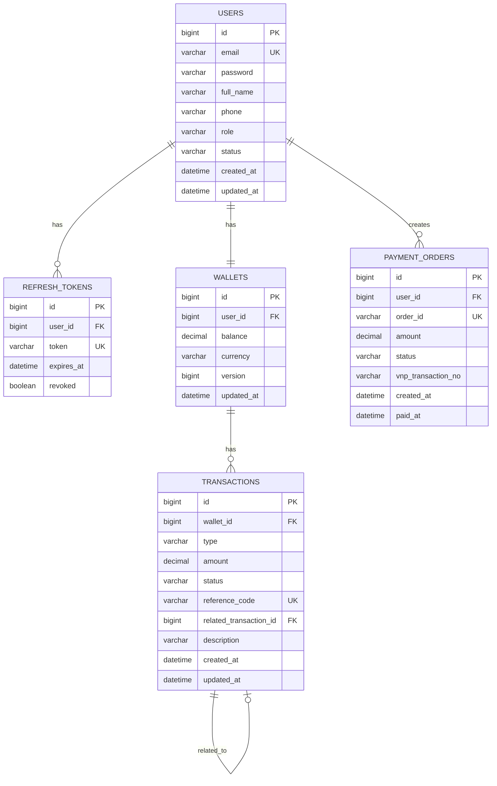
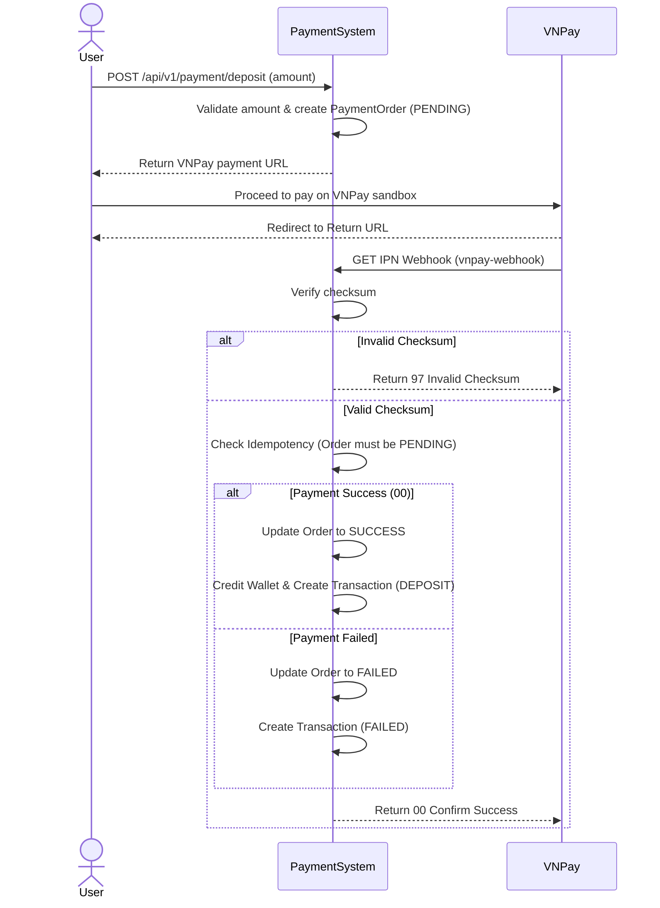
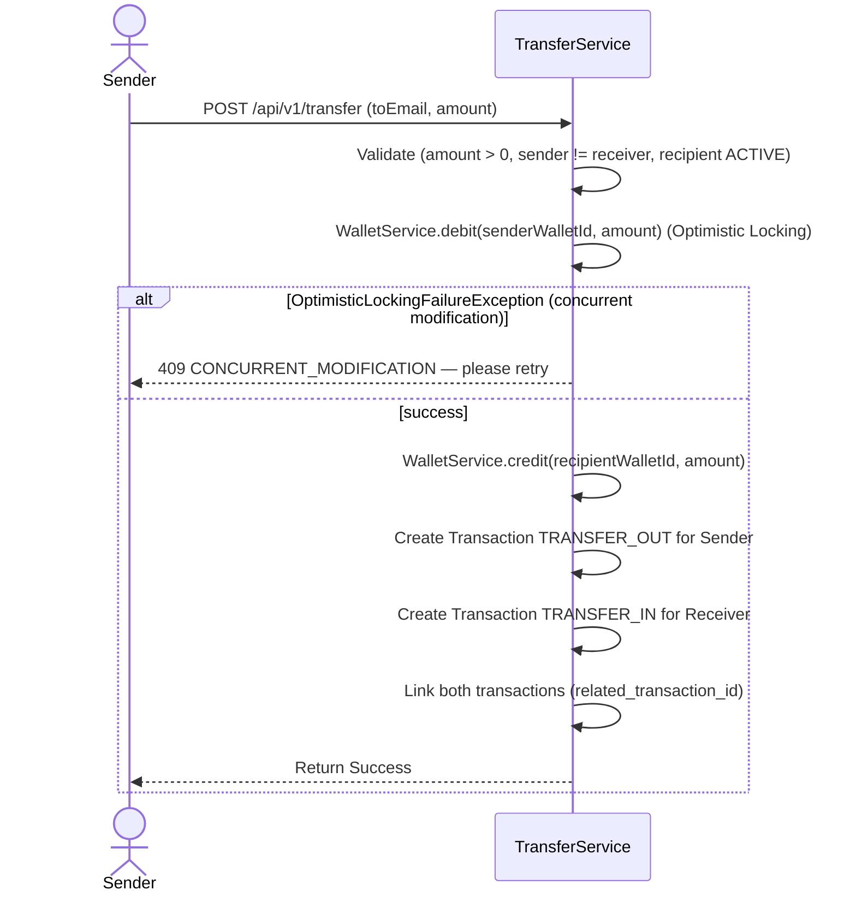
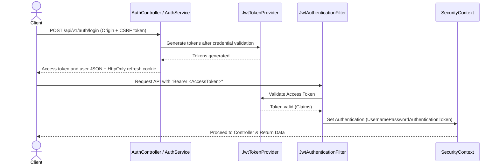

# Payment System

[](https://adoptium.net/)
[](https://spring.io/projects/spring-boot)
[](#testing)

A monolithic backend service (REST API) built with Spring Boot for a simple e-wallet system. It handles user registration, wallet balance management, internal fund transfers with concurrency control, and integrates with the VNPay sandbox for depositing funds.

## Features

- **Account Management**: Register, login, refresh tokens, and logout. One active refresh session per user; previous refresh tokens are revoked upon new login.
- **Wallet & Balance**: Automatically provisions a wallet for new users. Users can retrieve their current balance.
- **VNPay Deposit**: Create a deposit order returning a VNPay payment URL. A webhook endpoint processes the VNPay IPN callback to credit the wallet exactly once (idempotent).
- **Fund Transfer**: Secure internal transfer between users. Enforces self-transfer restrictions, sufficient balance checks, and handles concurrent requests using Optimistic Locking.
- **Transaction History**: Track all deposit, transfer_in, and transfer_out activities. Provides a paginated history endpoint with filtering by type, status, and date.
- **Admin Management**: Dedicated admin endpoints to fetch all system transactions and lock/unlock user accounts.

## Tech Stack

| Layer            | Technology                                  |
|------------------|---------------------------------------------|
| Language         | Java 17                                     |
| Framework        | Spring Boot 3.4.1                           |
| Build Tool       | Maven                                       |
| Database         | PostgreSQL 16                               |
| ORM              | Spring Data JPA (Hibernate)                 |
| Security         | Spring Security + jjwt (0.12.6)             |
| Payment Gateway  | VNPay Sandbox                               |
| Documentation    | springdoc-openapi-starter-webmvc-ui (2.8.4) |
| Containerization | Docker, Docker Compose                      |
| Testing          | JUnit 5, Mockito                            |

## Getting Started

### Prerequisites

- Java 17
- Docker & Docker Compose
- Maven

### Installation

```bash
git clone https://github.com/TrinhDacNhatMinh/payment-system-backend.git

cd payment-system-backend

cp src/main/resources/application.yaml.example src/main/resources/application.yaml

cp docker-compose.yml.example docker-compose.yml

# Fill in application.yaml and docker-compose.yml before starting.
docker compose up -d --build
```

### Configuration

- Copy `src/main/resources/application.yaml.example` to `src/main/resources/application.yaml`, then configure PostgreSQL, JWT, and VNPay. Use a JWT secret of at least 32 UTF-8 bytes.
- Copy `docker-compose.yml.example` to `docker-compose.yml`, then configure the same database name, username, and password. Docker sets the backend database URL to `db:5432`.

### Running

```bash
# Run the application locally with the project root as the working directory
mvn spring-boot:run

# Build and run the backend and PostgreSQL with Docker
docker compose up -d --build

# Run tests
mvn test
```

## API Documentation

**Swagger UI:** http://localhost:8080/swagger-ui.html

| Method | Endpoint                          | Description                                | Auth                                   |
|--------|-----------------------------------|--------------------------------------------|----------------------------------------|
| POST   | `/api/v1/auth/register`           | Register a new user                        | CSRF + Origin                          |
| POST   | `/api/v1/auth/login`              | Return access token and set refresh cookie | CSRF + Origin                          |
| POST   | `/api/v1/auth/refresh`            | Rotate tokens using refresh cookie         | CSRF + Origin + refresh cookie         |
| POST   | `/api/v1/auth/logout`             | End session and clear cookies; repeatable  | CSRF + Origin; optional refresh cookie |
| GET    | `/api/v1/wallet/me`               | Get current user's wallet balance          | USER                                   |
| POST   | `/api/v1/payment/deposit`         | Create a VNPay deposit URL                 | USER                                   |
| GET    | `/api/v1/payment/vnpay-webhook`   | VNPay IPN Webhook callback                 | None                                   |
| GET    | `/api/v1/payment/vnpay-return`    | VNPay Return URL callback                  | None                                   |
| POST   | `/api/v1/transfer`                | Transfer funds to another user             | USER                                   |
| GET    | `/api/v1/transactions`            | View personal transaction history          | USER                                   |
| GET    | `/api/v1/admin/transactions`      | View all system transactions               | ADMIN                                  |
| PATCH  | `/api/v1/admin/users/{id}/lock`   | Lock a user account                        | ADMIN                                  |
| PATCH  | `/api/v1/admin/users/{id}/unlock` | Unlock a user account                      | ADMIN                                  |

## Project Structure

```text
src/main/java/com/minh/paymentsystem/
├── auth/
├── common/
├── config/
├── payment/
├── transaction/
├── transfer/
├── user/
└── wallet/
```

---

## Architecture & Design Docs

### Overview

The system follows a **Monolith** architecture organized by **package-by-domain** principles. Each domain (auth, wallet, payment, etc.) encapsulates its own Controller, Service, Repository, and DTOs. This reduces cross-domain coupling. A `common` package serves as the shared kernel for global exception handling and base response structures.

### Service Dependency

The application enforces boundaries by ensuring Controllers only call their respective Services, and Services do not directly manipulate the Repositories of other domains.

- `AuthController` -> `AuthService` -> `UserService`, `RefreshTokenService`, `WalletService` (to create wallet)
- `TransferController` -> `TransferService` -> `UserService` (to fetch user info), `WalletService` (for debit/credit), `TransactionService` (to log transactions)
- `PaymentController` -> `PaymentService` -> `UserService` (to fetch user info), `PaymentGatewayService` (interface abstraction), `WalletService`, `TransactionService`

### Database Schema (ERD)



### Sequence Diagram — Deposit (VNPay)



### Sequence Diagram — Transfer



### Sequence Diagram — JWT Authentication Flow



### Key Technical Highlights

- **Optimistic Locking**: Implemented via `@Version` on the `Wallet` entity to detect concurrent wallet updates and roll back conflicting transactions.
- **Idempotency Control**: The VNPay IPN webhook uses the `order_id` to ensure that even if VNPay sends multiple callbacks, the wallet is credited exactly once.
- **Interface-based Gateway**: The `PaymentGatewayService` is defined as an interface, making the `PaymentService` completely decoupled from VNPay. This allows seamlessly integrating or swapping in any other third-party payment providers in the future.
- **Single-session Refresh**: Login, refresh, and logout coordinate through a user-row lock; new login revokes previous refresh tokens.

## Testing

`mvn test`

Tested components:

- `AuthServiceImplTest` (register, login, refresh, logout)
- `PaymentServiceImplTest` (deposit, webhook callback handling)
- `TransactionServiceImplTest` (create, log, filter)
- `TransferServiceImplTest` (transfer happy/error paths)
- `TransferServiceConcurrencyTest` (simulated concurrent transfers)
- `UserServiceImplTest` (lock, unlock)
- `WalletServiceImplTest` (credit, debit limits)
